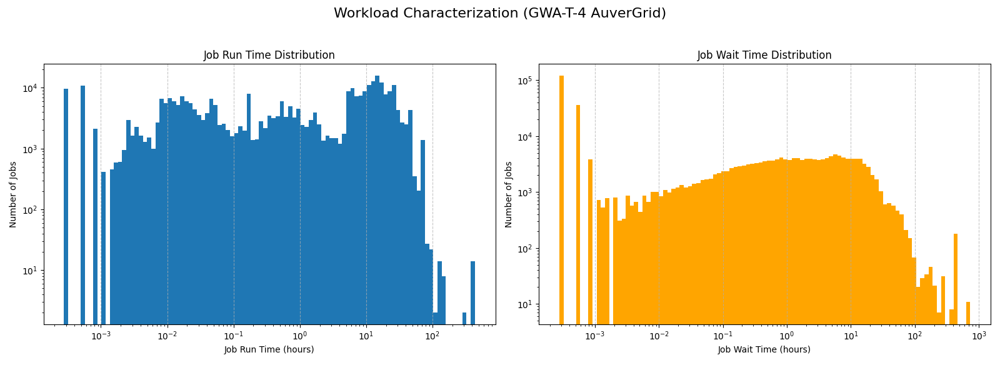
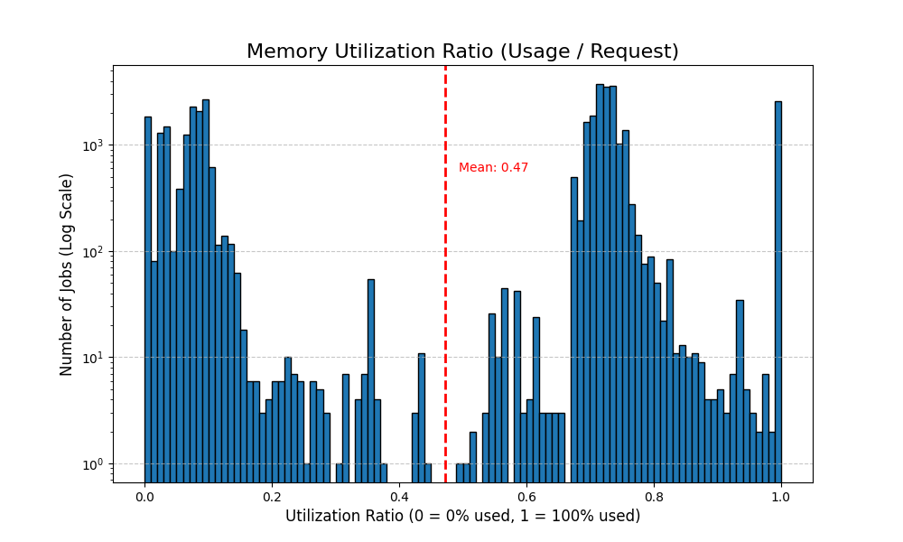
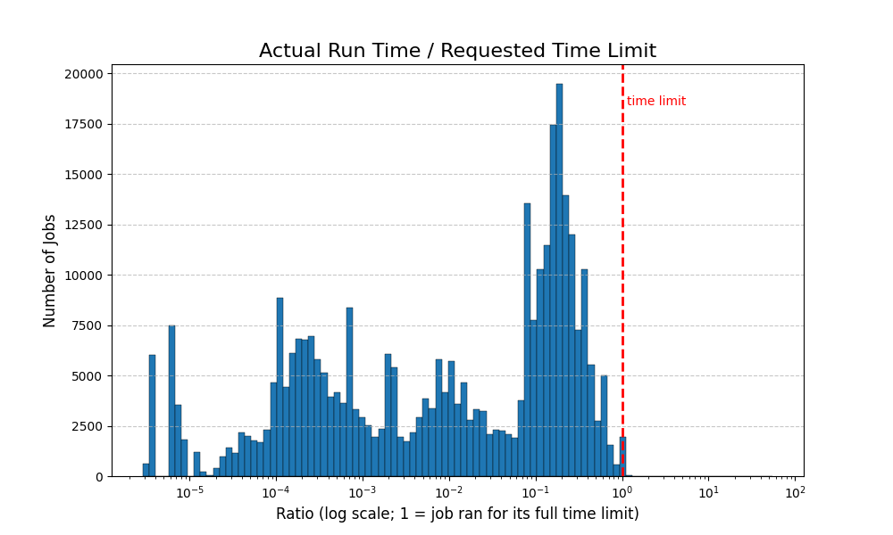
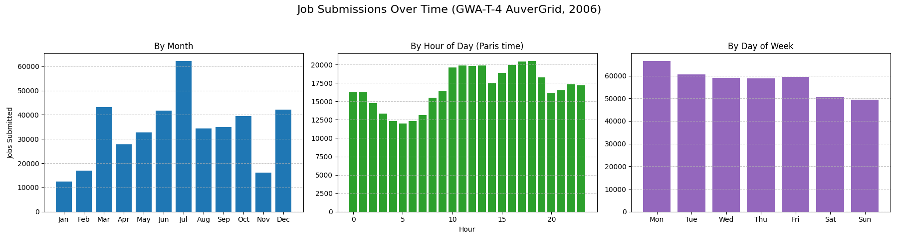
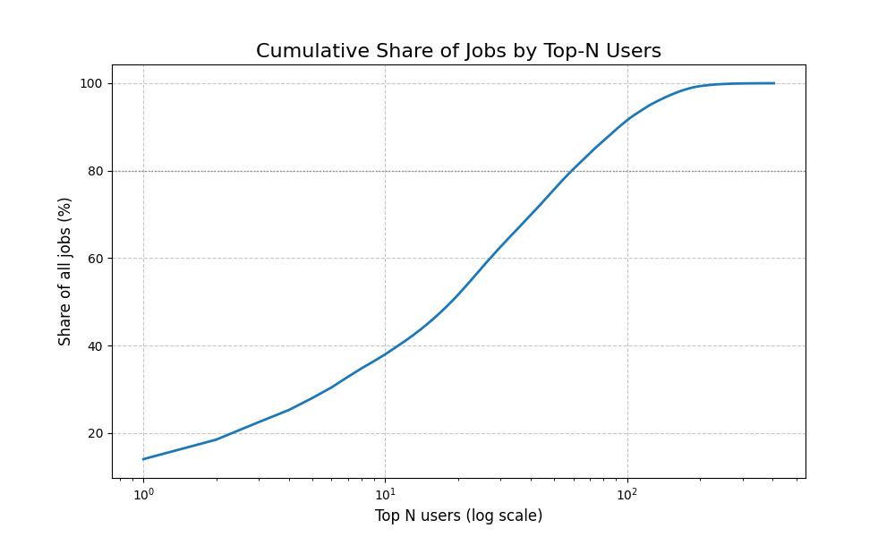

# GWA-T-4 AuverGrid Workload Analysis

[](https://colab.research.google.com/github/chandana-galgali/Analysis-of-the-GWA-T-4-AuverGrid-Workload/blob/main/Analysis_of_the_GWA_T_4_AuverGrid_Workload.ipynb)

A short workload-characterization study of the **GWA-T-4 AuverGrid** trace from the [Grid Workloads Archive](http://gwa.ewi.tudelft.nl/). The trace has **404,176 jobs** submitted over **one year (Jan–Dec 2006)** to AuverGrid, a production grid of 5 clusters (475 CPUs in total) in the Auvergne region of France. The grid was used mostly for biomedical and high-energy-physics research.

The notebook loads the trace from SQLite with **pandas** and plots it with **matplotlib**. It looks at five questions that come up often in HPC and distributed-systems research:

1. **What do the jobs look like?** Distributions of job run times and queue wait times.
2. **How well do users estimate memory?** Memory requested vs memory actually used.
3. **How tight are time limits?** Requested wall-time limit vs actual run time.
4. **When is the grid busy?** Submissions by month, hour of day and weekday.
5. **Who generates the load?** How concentrated the jobs are among users.

**🌐 Interactive version:** the findings are also published as a one-page website. The source is [`docs/index.html`](docs/index.html), served with GitHub Pages at `https://chandana-galgali.github.io/Analysis-of-the-GWA-T-4-AuverGrid-Workload/`.

## Key findings

| Metric | Value |
|---|---|
| Jobs in trace | 404,176 (from 405 users) |
| Median run time (jobs that ran) | ~44 min (mean ~7.2 h) |
| Median wait time | ~58 s (mean ~2.7 h) |
| Job outcome | 83% completed, 16% cancelled, 1% failed |
| Parallelism | All jobs are single-processor |
| Jobs that specified a memory request | 35,826 (~9%) |
| Memory utilization (used / requested) | mean 0.47, median 0.71 |
| Jobs using <10% of requested memory | ~38% |
| Median run time ÷ time limit | 1.3% (64% of jobs use <10% of their limit) |
| Most common time limits | 72 h (72% of jobs), 96 h (19%) |
| Busiest vs quietest month | Jul: 62k jobs vs Jan: 12k |
| User concentration | top user 14%, top 10 users 38%, 60 users (15%) → 80% of jobs |

### 1. Run times and wait times



- **Run times are heavy-tailed and multimodal.** They span about six orders of magnitude, from seconds to more than 400 hours. One large group of jobs finishes in seconds to minutes, which looks like tests or failed starts. A second large group runs for roughly 5–50 hours, which looks like real production work. A visible cut-off around 72 hours most likely matches the queue's wall-time limit.
- **Most jobs barely wait.** About half start within a minute. A long tail of jobs waits for hours and some for days, so the mean wait (~2.7 h) is far above the median. This is typical when a few busy periods dominate the queueing delay.

### 2. Memory utilization



- **The distribution is strongly bimodal.** One group of jobs uses less than about 15% of the memory it asked for. The other uses 70–80%, with a small spike at 100% (ratios are capped at 1.0).
- The **mean of 0.47 falls between the two groups and describes almost no real job.** The median of 0.71 is more representative, but the main point is that over a third of jobs request at least 10× the memory they need. A scheduler that reserves memory based on requests would waste a lot of capacity on these jobs.
- *Caveat:* only ~9% of jobs specified a memory request at all (the rest have `ReqMemory = -1`). These results describe that subset only.

### 3. Requested time limit vs actual run time



- About 91% of jobs carry a limit of exactly 72 h or 96 h. These look like queue defaults rather than users' own estimates.
- The median job uses **1.3%** of its limit, and almost no job comes close to it. Backfilling schedulers plan with these limits, so limits this loose take away most of what backfilling could gain.

### 4. Submission patterns



- Load varies widely across the year: July had about 5× as many submissions as January.
- Within a day, submissions bottom out around 5 am and stay high from mid-morning into the evening. Weekends account for about 25% of submissions, so they are quieter but not idle. This suggests much of the work is submitted by scripts and pipelines.

### 5. User concentration



- The single most active user submitted 14% of all jobs, and 60 of 405 users account for 80% of the workload. This kind of skew is why grids use fair-share scheduling.

## Repository structure

```
.
├── Analysis_of_the_GWA_T_4_AuverGrid_Workload.ipynb   # the analysis (runs locally or on Colab)
├── data/
│   └── gwa_t_4_anon_jobs_sqlite.zip                    # GWA-T-4 trace (anon_jobs.db3 + original README)
├── figures/                                            # plots produced by the notebook
├── docs/                                               # project website (GitHub Pages)
│   ├── index.html                                      #   single self-contained page, no build step
│   └── data.js                                         #   aggregates generated by the script below
├── scripts/
│   └── export_site_data.py                             # regenerates docs/data.js from the trace
├── requirements.txt
└── LICENSE
```

## How to run

**On Colab:** click the badge above and run all cells. The first cell downloads and extracts the trace automatically.

**Locally:**

```bash
git clone https://github.com/chandana-galgali/Analysis-of-the-GWA-T-4-AuverGrid-Workload.git
cd Analysis-of-the-GWA-T-4-AuverGrid-Workload
pip install -r requirements.txt jupyter
jupyter notebook Analysis_of_the_GWA_T_4_AuverGrid_Workload.ipynb
```

The setup cell extracts `data/anon_jobs.db3` from the zip on first run. Git ignores the extracted file.

## Data

The trace uses the Grid Workloads Archive format. The analysis uses these fields from the `Jobs` table:

| Column | Meaning |
|---|---|
| `SubmitTime` | Submission time (Unix epoch, seconds) |
| `WaitTime` | Time spent queued before starting (s) |
| `RunTime` | Wall-clock run time (s) |
| `NProc` | Processors allocated |
| `ReqMemory` / `UsedMemory` | Requested / used memory (KB); `-1` = not recorded |
| `ReqTime` | Requested wall-time limit (s) |
| `UserID` | Anonymized user |
| `Status` | 1 = completed, 0 = failed, 5 = cancelled |

## Acknowledgements

The AuverGrid traces were kindly provided by the **AuverGrid team** (special thanks to Dr. Emmanuel Medernach), the owners of the AuverGrid system, and are distributed through the **Grid Workloads Archive** (TU Delft). The trace's terms ask that published material using the data acknowledge its source.

> A. Iosup, H. Li, M. Jan, S. Anoep, C. Dumitrescu, L. Wolters, D. Epema. *The Grid Workloads Archive.* Future Generation Computer Systems, 24(7), 2008.

## License

The code in this repository is released under the [MIT License](LICENSE). The trace data remains subject to the Grid Workloads Archive / AuverGrid terms above.
